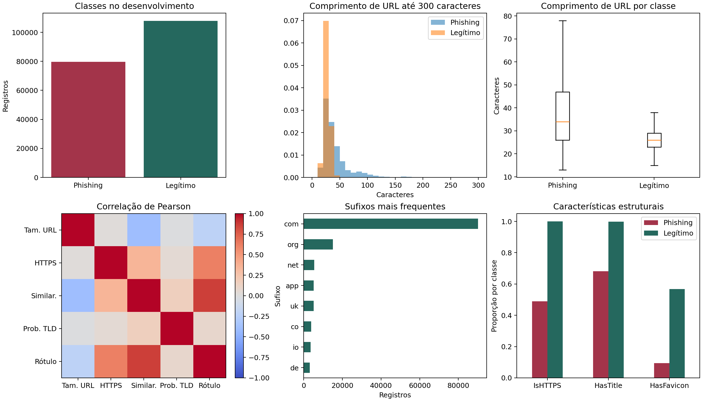

# Detecção Inteligente de Sites de Phishing por Aprendizado de Máquina: Uma Análise Comparativa com Ênfase em Generalização e Explicabilidade

## Resumo

Este estudo compara cinco modelos supervisionados e uma referência trivial para detectar phishing no PhiUSIIL. O modelo principal atingiu F1 de 0,99982 na reserva com domínios inéditos da mesma coleta. O modelo lexical atingiu 0,99645 nessa reserva e 0,71910 em um subconjunto de desenvolvimento com formato comum às duas classes, indicando sensibilidade ao padrão de coleta.
## Palavras-chave

Phishing, aprendizado supervisionado, generalização por domínio, explicabilidade.

## 1. Introdução

### 1.1 Contextualização

Phishing explora a confiança do usuário para induzir ações como informar credenciais ou dados financeiros. A estrutura de endereços e páginas fornece sinais para triagem supervisionada.

### 1.2 Problema de pesquisa

É possível identificar URLs fraudulentas associadas a phishing, a partir de características observáveis das URLs e páginas web, utilizando modelos supervisionados de aprendizado de máquina capazes de generalizar para registros não utilizados no treinamento?

### 1.3 Justificativa

Avaliações de URLs da mesma coleta podem compartilhar domínios e sinais introduzidos durante a coleta. A reserva por grupo e a investigação desses sinais ajudam a delimitar a validade do desempenho observado.

### 1.4 Objetivo geral

O objetivo é medir desempenho, generalização, custo computacional e interpretabilidade em um protocolo com avaliação final independente.

### 1.5 Objetivos específicos

Auditar os dados e seus atributos, comparar famílias de classificadores, estimar generalização por domínio, analisar os erros e demonstrar inferência lexical local.

## 2. Referencial teórico

### 2.1 Phishing e segurança da informação

Sites fraudulentos podem imitar elementos visuais de serviços legítimos. A identificação de combinações de sinais apoia a triagem de URLs na abordagem de Prasad e Chandra. [Artigo original](https://doi.org/10.1016/j.cose.2023.103545)

### 2.2 Aprendizado de máquina supervisionado

O treinamento a partir de exemplos rotulados estima uma regra para novos registros. A avaliação fora da amostra mede o desempenho sob as condições representadas pela partição.

### 2.3 Classificação binária

O modelo atribui uma pontuação à classe phishing. O limiar converte a pontuação em uma decisão e determina o compromisso entre falsos negativos e falsos positivos.

### 2.4 Regressão logística

A regressão logística modela a chance logarítmica como combinação linear dos atributos transformados. A regularização restringe a magnitude dos coeficientes.

### 2.5 Árvore de decisão

Divisões recursivas criam regiões de decisão não lineares. Limites de profundidade e tamanho mínimo de folha controlam a capacidade da árvore.

### 2.6 Random Forest

A floresta combina árvores treinadas em amostras reamostradas e considera subconjuntos de atributos nas divisões, o que reduz a dependência de uma única árvore. [Breiman](https://doi.org/10.1023/A:1010933404324)

### 2.7 Gradient Boosting

O boosting ajusta árvores sequencialmente para reduzir a perda. A variante experimental agrupa valores em histogramas para acelerar o ajuste tabular. [Friedman](https://doi.org/10.1214/aos/1013203451)

### 2.8 Naive Bayes

GaussianNB aplica o teorema de Bayes assumindo independência condicional dos atributos e distribuições gaussianas por classe. Contagens assimétricas e atributos correlacionados podem contrariar essas hipóteses.

### 2.9 Validação cruzada

Cada fold de validação avalia dados fora de seu ajuste. A validação agrupada evita que registros de um domínio registrável apareçam simultaneamente nos dois lados de um fold.

### 2.10 Métricas de classificação

F1 é a média harmônica de precisão e recall. F2 dá mais peso ao recall. AUC ROC e average precision resumem a ordenação das pontuações. A área trapezoidal precisão-recall responde a outra regra de integração e é registrada separadamente.

### 2.11 Vazamento de informação

Vazamento ocorre quando o modelo usa informações provenientes do alvo, do conjunto avaliado ou de dados indisponíveis no momento da previsão. A procedência do atributo determina a investigação.

### 2.12 Inteligência artificial explicável

A permutação estima a variação de desempenho ao embaralhar um atributo. Coeficientes e perturbações locais descrevem associações e sensibilidades do modelo ajustado.

## 3. Metodologia

### 3.1 Caracterização da pesquisa

Estudo empírico comparativo, com os modelos avaliados sobre as mesmas partições sempre que aplicável.

### 3.2 Conjunto de dados

A inspeção percorreu os CSVs para validar cabeçalho, largura dos registros, tipos observados e distribuição do alvo. Cada fonte foi auditada em separado. O ZIP e o CSV oficiais foram preservados por bytes.

| Fonte | Arquivo | Registros | Colunas | Alvo e contagem observada |
|---|---|---:|---:|---|
| Kaggle v2 | `dataset.csv` | 11.055 | 32 | `Result` com 6.157 valores 1 e 4.898 valores −1 |
| UCI 967 | `PhiUSIIL_Phishing_URL_Dataset.csv` | 235.795 | 56 | `label` com 100.945 valores 0 e 134.850 valores 1 |

A edição Kaggle apresenta esquema diferente e fica restrita à auditoria. A UCI tem 54 preditores catalogados, além de `FILENAME` e `label`. Na fonte oficial, 0 representa phishing e 1 representa legítimo. O classificador usará a convenção inversa, com phishing como classe positiva. A conversão foi testada e o CSV bruto conserva os valores da origem.

O SHA-256 do CSV oficial é `a236549cd369cd80bd478ff8e1779cbf44c58d5c3f79f7a51a1adbed7d06d1c6`. As listas completas de atributos, os tipos observados e os hashes das duas fontes constam da [auditoria de referência](results/data_audit/eedb92afaef04c27b08941e64df07dfc.json).

### 3.3 Ambiente computacional

Windows 11, Python 3.13.7 e scikit-learn 1.7.2. O treinamento usou CPU com limite de quatro threads e dependências fixadas.

### 3.4 Análise exploratória

A exploração detalhada ocorreu somente no desenvolvimento após a reserva. Foram empregados perfil de qualidade, estatísticas por classe, distribuições, análise de extremos e correlações.

### 3.5 Auditoria dos atributos

Identificadores e textos brutos ficaram fora dos preditores. Escores com origem ou replicação incerta foram limitados ao diagnóstico A. [Auditoria de atributos](docs/auditoria_atributos.md)

### 3.6 Preparação dos dados

Três cenários mantêm as mesmas linhas e rótulos. A é abrangente e inclui os derivados incertos para diagnóstico. B exclui derivados e identificadores potencialmente problemáticos. C recalcula atributos lexicais com o mesmo código da aplicação. Os transformadores são ajustados em cada fold. Ausentes numéricos recebem mediana defensiva, categorias têm limite de dimensão e logísticas usam padronização.

### 3.7 Separação e validação

Entre as URLs normalizadas pela regra de barras finais, houve 1.590 repetições além da primeira ocorrência. Foram excluídas duas linhas conflitantes e dez URLs incompatíveis com o extrator. A reserva deixou 187.434 registros para desenvolvimento e 46.760 para teste (19,97% dos elegíveis). O agrupamento usa domínios registráveis da Public Suffix List e forma canônica para IPs. Os grupos do teste são disjuntos dos de desenvolvimento.

### 3.8 Modelos implementados

O experimento incluiu Dummy por prevalência, regressão logística, árvore de decisão, Random Forest, HistGradientBoosting e GaussianNB.

### 3.9 Otimização de hiperparâmetros

Quatro buscas aleatórias usaram duas combinações por família e cinco folds internos no treino grupal. O primeiro fold externo forneceu a validação independente da busca. [Reconstrução da partição da busca](results/experiments/completo-e00004fe47f74cb1994965d5c8d0d5b4/reconstrucao_folds.json)

### 3.10 Protocolo experimental

O desenvolvimento foi usado para escolher atributos, modelos e limiares. O manifesto congelado precedeu a execução única sobre a reserva. [Protocolo](docs/protocolo_experimental.md)

### 3.11 Critérios de seleção

Prioridade ao F1 de phishing entre os cenários elegíveis. Em diferenças de até 0,002, o protocolo estabelece os critérios de desempate de recall, estabilidade e custo. [Regra de seleção](docs/selecao.md)

## 4. Resultados e discussão

### 4.1 Caracterização dos dados

O desenvolvimento tem 79.583 registros de phishing e 107.851 legítimos. A inspeção encontrou zero nulos, vazios, infinitos, valores negativos e colunas constantes. IsDomainIP, HasObfuscation, NoOfObfuscatedChar, ObfuscationRatio e NoOfAmpersandInURL concentram pelo menos 99% das observações no valor modal. O comprimento de URL tem mediana de 34 caracteres em phishing e 26 em legítimos. O máximo observado foi 6.097 caracteres e 16.834 linhas estão além da cerca de 1,5 IQR. Esses extremos foram preservados.

### 4.2 Qualidade dos dados

Entre as correlações com o rótulo original, `URLSimilarityIndex` tem magnitude 0,860 e `HasSocialNet`, 0,784. A primeira motivou uma verificação da origem do escore. A segunda é compatível com diferenças entre as páginas coletadas e permanece como possível efeito de coleta. [EDA exportada](results/exploracao/painel.png) · [Auditoria de atributos](docs/auditoria_atributos.md)

O desenvolvimento tem 158.162 domínios registráveis, dos quais 152.601 aparecem em uma única linha. O gráfico usa a PSL e apresenta somente contagens agregadas. Pares de correlação absoluta de pelo menos 0,90 sinalizam redundância e são distinguidos de evidência de vazamento. [Gráfico de domínios](results/exploracao/dominios.png) · [Pares correlacionados](results/exploracao/correlacoes_altas.csv)

### 4.3 Resultados dos modelos iniciais

| Modelo | F1 médio B | Desvio B | F1 médio C |
|---|---:|---:|---:|
| Dummy por prevalência | 0,00000 | 0,00000 | 0,00000 |
| Regressão logística | 0,99898 | 0,00050 | 0,99414 |
| Árvore de decisão | 0,98747 | 0,02153 | 0,99575 |
| Random Forest | 0,99952 | 0,00040 | 0,99577 |
| HistGradientBoosting | 0,99966 | 0,00030 | 0,99655 |
| GaussianNB | 0,96253 | 0,00538 | 0,96012 |

### 4.4 Resultados da validação cruzada

Os cinco folds externos cobriram o desenvolvimento e tiveram zero domínios compartilhados. O desvio-padrão da tabela descreve variação entre folds. O F1 primário é da classe phishing.

### 4.5 Otimização dos modelos

| Busca no cenário B | F1 basal na validação interna | F1 otimizado na mesma validação | Tempo da busca (s) |
|---|---:|---:|---:|
| Regressão logística | 0,99909 | 0,99902 | 9,91 |
| Árvore de decisão | 0,99794 | 0,99853 | 13,46 |
| Random Forest | 0,99990 | 0,99990 | 14,79 |
| HistGradientBoosting | 0,99983 | 0,99990 | 36,90 |

A validação interna indica ganho para árvore e boosting, estabilidade para floresta e leve queda na regressão logística. As buscas testaram duas combinações por família, com cinco folds internos. A estimativa do teste fornece a verificação independente.

### 4.6 Comparação dos cenários experimentais

Com HistGradientBoosting, o F1 agrupado foi 0,99999 em A, 0,99966 em B e 0,99655 em C. A remoção dos derivados preservou F1 alto e a extração exclusivamente lexical reduziu o custo de implementação. A comparação de modelos sustenta vantagem do boosting e da floresta sobre o modelo linear, com diferença inferior a 0,001 no cenário B. [Resultados por fold](results/experiments/completo-e00004fe47f74cb1994965d5c8d0d5b4/comparacao.csv)

### 4.7 Generalização por domínio

A validação aleatória compartilhou de 2.512 a 2.543 grupos por fold. O F1 do boosting controlado mudou de 0,99966 para 0,99983 sob o protocolo aleatório. O lexical mudou de 0,99655 para 0,99644. A hipótese de ganho sistemático com a divisão aleatória não recebeu suporte nos dois cenários, mas a separação agrupada resolve a sobreposição observada. A curva lexical foi de 0,99552 com 37.917 linhas a 0,99622 com 151.669 linhas em uma validação fixa. [Comparação e curvas](results/experiments/completo-e00004fe47f74cb1994965d5c8d0d5b4/comparacao.png) · [Aprendizado e limiares](results/experiments/completo-e00004fe47f74cb1994965d5c8d0d5b4/curvas_C.png)

### 4.8 Interpretabilidade

A permutação apontou HTTPS como o maior sinal nos modelos selecionados. As linhas de código apareceram em segundo lugar no controlado. As importâncias são variações do F1 em dados de validação. [Importância lexical](results/experiments/completo-e00004fe47f74cb1994965d5c8d0d5b4/importancia_C.csv)

### 4.9 Análise de erros

Na análise de permutação, HTTPS foi o maior sinal nos dois modelos. Linhas de código apareceram em segundo lugar no controlado. O modelo lexical concentrou 83 falsos negativos no intervalo de até 35 caracteres, em 102 falsos negativos no total da validação. As perturbações locais registram a mudança de pontuação em falsos positivos, falsos negativos, acertos e pontos próximos ao limiar. [Erros por comprimento](results/experiments/completo-e00004fe47f74cb1994965d5c8d0d5b4/erros_C.csv) · [Casos locais](results/experiments/completo-e00004fe47f74cb1994965d5c8d0d5b4/casos_C.csv)

### 4.10 Seleção do modelo final

O HistGradientBoosting otimizado do cenário B foi selecionado como principal no desenvolvimento. Seu limiar de 0,175 elevou o F1 interno de 0,99990 para 0,99993. O HistGradientBoosting basal do cenário C foi congelado com limiar 0,50 para a demonstração. Os artefatos foram reajustados sobre 187.434 linhas antes da abertura da reserva. A avaliação usou a mesma reserva agrupada em uma sessão única para os dois modelos pré-especificados. [Manifesto congelado](results/experiments/completo-e00004fe47f74cb1994965d5c8d0d5b4/freeze.json) · [Registro da execução](results/final/39293c0cc63702da8f5475cb060b878905ac68284c06479919d0f138e8157b8f/execucao.json)

### 4.11 Avaliação no conjunto de teste

| Modelo no teste de 46.760 registros | F1 | Precisão | Recall | ROC-AUC | Falsos positivos | Falsos negativos |
|---|---:|---:|---:|---:|---:|---:|
| B, principal | 0,99982 | 0,99985 | 0,99980 | 0,999999 | 3 | 4 |
| C, lexical | 0,99645 | 0,99934 | 0,99357 | 0,998740 | 13 | 127 |

### 4.12 Eficiência computacional

Em Windows 11, Python 3.13.7 e scikit-learn 1.7.2, com limite de quatro threads e 16 processadores lógicos disponíveis, os ajustes finais levaram 2,73 s e 2,54 s em B e C. Os Joblib comprimidos tiveram 138.548 e 141.577 bytes. A inferência do lote levou 0,646 s em B e 0,257 s em C, sem contar leitura do arquivo e extração lexical. O pico de memória por modelo ficou fora da instrumentação. [Métricas completas](results/final/39293c0cc63702da8f5475cb060b878905ac68284c06479919d0f138e8157b8f/metrics.json) · [Curvas e matriz B](results/final/39293c0cc63702da8f5475cb060b878905ac68284c06479919d0f138e8157b8f/avaliacao_B.png) · [Curvas e matriz C](results/final/39293c0cc63702da8f5475cb060b878905ac68284c06479919d0f138e8157b8f/avaliacao_C.png)

### 4.13 Discussão dos resultados

Os números das tabelas são resultados próprios. A publicação de Prasad e Chandra é fonte para a descrição do conjunto e dos atributos, e suas métricas dependem do protocolo que a originou.

Todos os 107.851 legítimos do desenvolvimento seguem um mesmo perfil combinado de esquema, prefixo e caminho. Apenas 812 de 79.583 exemplos de phishing têm esse perfil. No subconjunto de formato comum da validação interna, com 165 positivos entre 21.612 registros, o F1 lexical caiu de 0,99622 para 0,71910 e o recall para 58,18%. Já o modelo controlado atingiu F1 de 0,99698 nesse subconjunto. A mudança de prevalência também afeta o F1 e limita a interpretação isolada. [Contagens por formato](results/exploracao/formato_coleta.json) · [Análise de sensibilidade](results/experiments/completo-e00004fe47f74cb1994965d5c8d0d5b4/sensibilidade_coleta.json)

## 5. Aplicação desenvolvida

O [protótipo Streamlit](app/streamlit_app.py) aceita endereços HTTP e HTTPS, valida o esquema e o hash do pipeline, mostra uma pontuação sem calibração e apresenta resultados persistidos. Seu uso indica triagem educacional. Para adoção operacional, são necessárias uma coleta com formatação comparável entre classes, avaliação em outra fonte, validação temporal e calibração sob prevalência realista.

## 6. Limitações e ameaças à validade

O conjunto é estático e pode refletir o viés de coleta dos autores. Domínios inéditos nesta coleta medem independência entre grupos. Mudanças temporais de distribuição, ataques recém-observados e coleta em produção exigem avaliação própria. O CSV usado carece de datas apropriadas para teste temporal. O modelo lexical usa a estrutura de endereços. O modelo de página depende dos indicadores extraídos na coleta.

## 7. Aspectos éticos e de segurança

Falsos negativos deixam ameaças passar e falsos positivos podem provocar bloqueios indevidos. A importância por permutação mede a dependência do modelo sob perturbações. A associação observada é descritiva e depende da amostragem e da colinearidade dos atributos. A aplicação analisa a entrada localmente e evita armazená-la ou acessar o site.

O uso recomendado é a demonstração educacional. Decisões de bloqueio e tratamento de URLs potencialmente sensíveis requerem avaliação e controles adequados ao ambiente de uso.

## 8. Conclusão

Sim, dentro do PhiUSIIL os modelos identificaram phishing em registros de domínios ausentes do desenvolvimento. A avaliação e o diagnóstico de formato delimitam essa conclusão à coleta utilizada. O modelo lexical é viável para demonstrar inferência local, com sensibilidade considerável ao padrão de representação do conjunto.

## 9. Trabalhos futuros

Construir uma coleta com representação comparável por classe, validar em fontes independentes e em períodos posteriores, estimar calibração sob prevalência realista e medir memória de treinamento separadamente por modelo.

## Referências

- Prasad, A. e Chandra, S. PhiUSIIL Phishing URL (Website). UCI Machine Learning Repository, 2024. [Catálogo UCI](https://archive.ics.uci.edu/dataset/967/phiusiil%2Bphishing%2Burl%2Bdataset)
- Prasad, A. e Chandra, S. PhiUSIIL: A diverse security profile empowered phishing URL detection framework based on similarity index and incremental learning. Computers & Security, artigo 103545. [DOI](https://doi.org/10.1016/j.cose.2023.103545)
- Prasad, A. e Chandra, S. PhiUSIIL Phishing URL Dataset, versão 2. Mendeley Data, 2023. [Registro Mendeley](https://data.mendeley.com/datasets/shwpxscxy2/2)
- Breiman, L. Random Forests. Machine Learning, 45, 5–32, 2001. [Publicação](https://doi.org/10.1023/A:1010933404324)
- Friedman, J. H. Greedy Function Approximation: A Gradient Boosting Machine. The Annals of Statistics, 29(5), 1189–1232, 2001. [Publicação](https://doi.org/10.1214/aos/1013203451)
